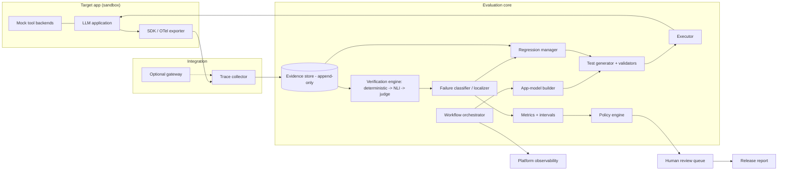
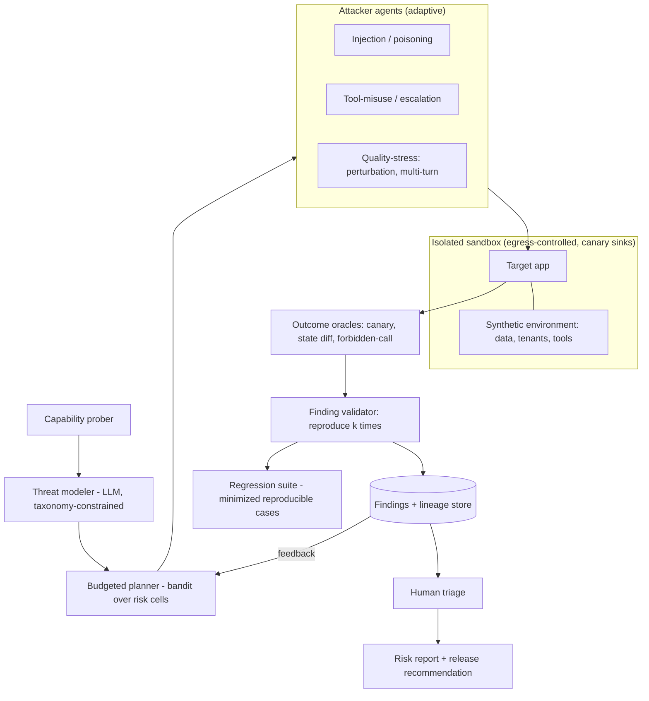
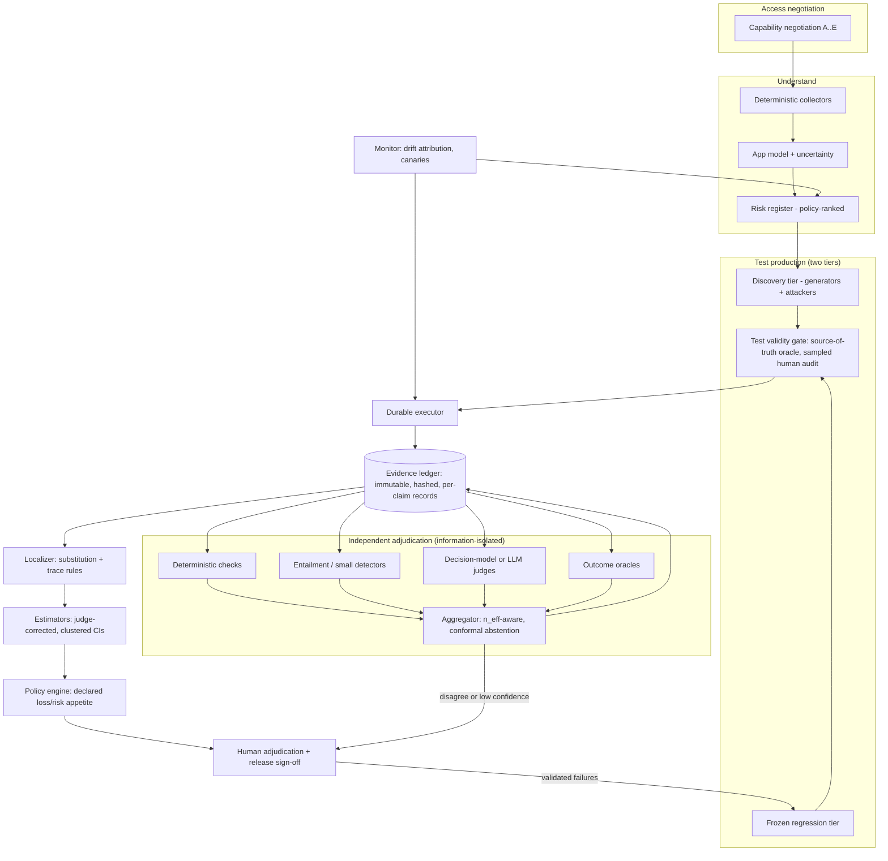

# 16 — Architecture Candidates (three genuinely different options; **no selection made**)

Written after `02`–`15`. Each component is tagged for feasibility (`21` legend): **EP** existing proven · **OS** open-source available · **EI** engineering integration · **OR** original research · **SP** speculative.

The candidates differ in their *center of gravity*: A = observed evidence, B = adversarial search, C = an evidence ledger with independent adjudication.

---
## Candidate A — Instrumented Evaluation & Verification Platform (trace-centric)

**Thesis:** quality evidence comes from instrumentation; deterministic assertions and a verifier portfolio do most work; LLMs are used sparingly.

- **Strength:** reproducible, auditable, strong localization where instrumented. Evidence: structural testing (arXiv:2601.18827).
- **Weakness:** needs instrumentation (B/C); weak on unknown-unknown discovery; coverage bounded by what tests are written/generated.
- **Components:** collector (EP/OS: OTel), evidence store (EI), verifier portfolio (EI + OR for independence), localizer (EI for rules, OR for black-box).

---
## Candidate B — Autonomous Risk-Driven Adversarial Testing Platform (search-centric)

**Thesis:** discovery comes from agents that model the app, hypothesize failure modes, and search adaptively; verdicts come from outcome oracles in sandbox.

- **Strength:** best evidence for finding failures static suites miss (adaptive attack results, `10`).
- **Weakness:** cost and nondeterminism; metrics hard to compare run to run; quality (non-security) oracles weaker; needs environment synthesis for arbitrary apps (OR/SP).
- **Components:** attacker orchestration (OS: AJAR/PyRIT/Petri patterns), outcome oracles (EI), environment synthesis (**OR/SP**), minimizer (**OR**).

---
## Candidate C — Hybrid Quality-Engineering System with an Independent Evidence Ledger

**Thesis:** combine A's structure and B's discovery, but make *adjudication independence* an explicit subsystem: findings are not accepted until verified by a method-diverse portfolio under information isolation, with calibrated abstention to humans.

- **Strength:** addresses the two weakest links found in the literature: oracle independence and test validity. Natural place to record "unknown/insufficient evidence."
- **Weakness:** largest scope; several parts are OR (app model, independence measurement, localization); easiest to over-claim.
- **Components:** ledger (EI), diverse verifier portfolio (EI/OR), conformal abstention (OS techniques, EI), validity gate (OR), policy engine (EI).

---
## Cross-cutting design sections (apply to all three)

### B. Internal architecture notes
Orchestration as a **durable workflow** (resume after failure; idempotent steps; Temporal-style — engineering judgment). Sync: connect/discover/human review. Async: generation, execution, verification (queue-based, rate-limit-aware). Events: `TestExecuted`, `EvidenceRecorded`, `VerdictIssued`, `FindingConfirmed`, `DecisionProposed`. Retries: transport-level automatic; **verdict-level retries only with logged reason** (retry-until-pass is a bias).

### C. Multi-agent structure
Typed events via orchestrator; no free-form inter-agent chat; verifiers see claims+evidence pointers, never producer rationale; deterministic services for execution, estimation, policy, ledger (see `08`).

### D. Data architecture
Entities: `AppModel`, `Risk`, `TestCase{lineage, oracle_source, validity_status}`, `Run`, `Trace/Span`, `EvidenceRecord`, `Verdict{method, version, calibration_id}`, `Failure{type, location, localization_confidence}`, `RegressionCase{minimized, pass^k admission}`, `Decision{policy_version, evidence_ids, approver}`. Lineage: content-addressed IDs, append-only, signed timestamps; every report number traces to evidence IDs.

### E. Security architecture
Trust boundaries: platform ↔ sandbox ↔ target ↔ third parties. Secrets in vault, short-lived test credentials, synthetic data only, egress allowlist with canary sinks, per-run budgets and kill switch, repo content treated as untrusted input, judges isolated from attacker-controlled text where possible, full audit log.

### F. Scalability
Parallelism limited by provider rate limits and by *stateful* tests (isolated sandboxes per run); storage dominated by traces; cost control via cascade and deterministic-first funnels. No throughput numbers are claimed (not measured).

### G. Deployment
| Mode | Pros | Cons |
|---|---|---|
| Local | Data stays put; easy dev | Limited scale; reproducibility depends on user env |
| Containerized self-host | Reproducible; fits enterprise | Ops burden |
| Cloud SaaS | Easy scale, shared judge infra | Data exposure; many enterprises disallow |
| Hybrid (control plane cloud, data plane in customer VPC) | Balances | Complexity |

### H. Feasibility summary
| Component | A | B | C |
|---|---|---|---|
| Trace ingestion (OTel) | EP/OS | EI | EP/OS |
| Deterministic checks/assertions | EP | EP | EP |
| Verifier portfolio (NLI+judge) | OS/EI | EI | EI + **OR** (independence) |
| App-model extraction | EI/**OR** | **OR** | **OR** |
| Adaptive attackers | — | OS/EI | OS/EI |
| Env synthesis for arbitrary apps | — | **OR/SP** | **OR/SP** |
| Test validity gate | EI | EI | **OR** |
| Localization | EI (grey-box) | partial | EI + **OR** (black-box) |
| Conformal abstention/gates | EI | EI | EI |
| Drift attribution | EI/**OR** | — | **OR** |

No candidate is endorsed here; `19` and `22` list what must be learned to choose.
