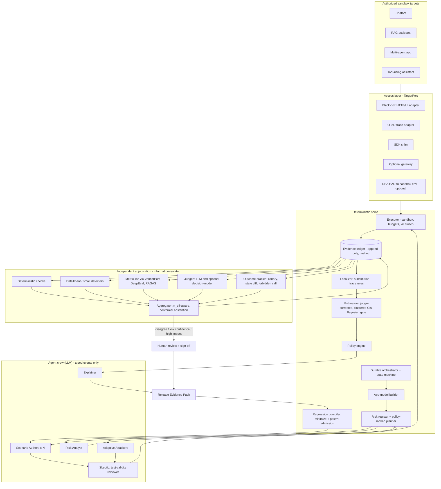
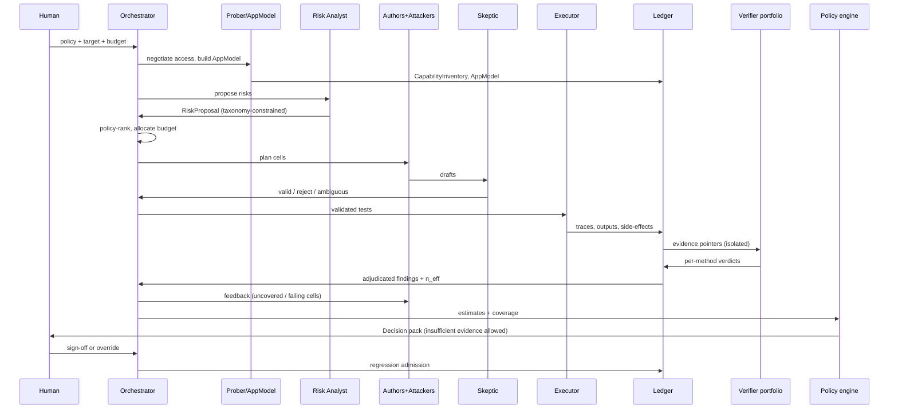

# 24 — Solution Plan: Multi-Agent Quality Engineering Platform for LLM Applications

Status: **plan**, derived from `01`–`23`. This is the first document where an architecture is *chosen*, because you asked for a solution plan. Every claim about superiority is a **hypothesis with a pre-defined kill test** (§11). The product name is deliberately left open; this doc says "the Platform."

## 1. The decision in brief
Build a **vendor-neutral pre-release verification and release-evidence layer** that sits *on top of* existing tracing/eval stacks (OTel, Langfuse/Phoenix/DeepEval/RAGAS) rather than replacing them. Architecture = **Candidate C, staged**: an evidence-ledger spine (Candidate A) first, adaptive attacker/generator agents (Candidate B) as modules, and an **independent adjudication subsystem** as the differentiator.

What it is **not**: another dashboard, another metric library, another red-team scanner. Those exist (`13`).

## 2. Why this can stand in the market — and where it cannot
**Evidence-backed market facts (from this research):**
- The eval/observability layer is crowded and consolidating: ClickHouse bought Langfuse (Jan 2026); OpenAI announced buying Promptfoo (Mar 2026); DeepEval, RAGAS, Phoenix, TruLens, MLflow, LangSmith, Braintrust all cover tracing + judges + datasets + CI-style gates (`13`). The two largest open frameworks we ingested are component libraries, not release-decision systems (`23`).
- Release gating already exists in research (`18`). So "we recommend release" is table stakes, not a moat.
- Buyers' real pain evidenced in literature: judge panels give false redundancy (Kohli), static security suites overstate robustness (Nasr et al.), and reliability collapses under repetition (τ-bench pass^k).
- Platform owners (OpenAI, ClickHouse, LangChain) are structurally **not neutral** about verifying across providers; a neutral verifier has a plausible wedge. *(Inference, not evidence.)*

**Where we are weak:** incumbents have distribution, integrations and data gravity; our differentiators are unproven (H1–H4); outcome-based security needs per-app environments; "RELEASE" can create false assurance.

**Therefore the defensible position is evidence quality, not features:** every verdict ships with *access level, independence of verifiers (n_eff), invalid-test rate, attacker budget, risk-register coverage, and an explicit "insufficient evidence" outcome.* If benchmarks (§11) do not show a measurable advantage on held-out apps, the fallback is an **open reporting standard + adapters** (still useful, lower commercial value).

## 3. Product definition (MVP scope)
**User:** an AI-platform / QA / risk engineer who must decide whether an LLM app version ships.
**Input:** an authorized sandbox target (HTTP API / chat UI / OTel feed / repo read access), a policy file (risk appetite, loss weights, required evidence), optional source-of-truth docs.
**Output:** a signed **Release Evidence Pack**: decision (RELEASE / CONDITIONAL / REJECT / INSUFFICIENT-EVIDENCE), conditions, risk-register coverage with uncovered areas, per-finding evidence with localization confidence, estimator tables with intervals, verifier-independence report, regression suite delta, human sign-off record.
**Non-goals (MVP):** production traffic enforcement, fine-tuning, certification claims, auto-fixing apps.

## 4. Architecture (chosen)

## 5. Multi-agent testing design
### 5.1 Principle
Agents (LLMs) **propose**; deterministic services **execute, measure and decide**. No agent can write evidence, compute a score, or issue a decision. (Basis: `08`; MAD results show debate gains are unreliable; judge panels are correlated.)

### 5.2 Roster
| Component | Kind | Responsibility | Reads | Writes (typed events only) | Notes |
|---|---|---|---|---|---|
| Connector / Capability Prober | deterministic | negotiate access level A–E, probe capabilities | target | `CapabilityInventory` | no LLM needed |
| App-Model Builder | deterministic + LLM annotator | graph of components/tools/permissions/data stores from traces, OpenAPI, repo, REA output | inventory, traces | `AppModel` (+uncertainty) | ragas `KnowledgeGraph` pattern |
| **Risk Analyst** | LLM agent | enumerate risk×surface cells, constrained to OWASP LLM/Agentic taxonomies and app model | AppModel, taxonomy | `RiskProposal` | ranking is done by policy, not by the agent |
| Planner/Budgeter | deterministic | allocate tests/budget over cells (bandit), set stop rules | register, policy | `TestPlan` | |
| **Scenario Authors (N, heterogeneous models)** | LLM agents | generate scenarios, variants, metamorphic relations from **source-of-truth docs** | plan, docs | `TestCaseDraft` | different base models to reduce shared blind spots |
| **Adaptive Attackers** | LLM agents + search | multi-turn/indirect injection, tool-misuse, poisoning within budget | AppModel, plan | `AttackAttempt` | outcome judged only by oracles |
| **Skeptic (test-validity reviewer)** | LLM agent + deterministic checks | try to show each draft test is invalid, ambiguous or redundant; re-derive expected behavior independently | draft, sources | `ValidityVerdict` | sampled human audit calibrates it; invalid-test rate reported |
| Executor | deterministic | run in sandbox with test identities, seeds, budgets, kill switch, repeated runs | validated tests | `RunRecord`, `Trace` | idempotent, resumable |
| Evidence Ledger | deterministic | immutable, hashed, per-claim records with lineage | all events | — | single writer |
| Verifier portfolio | deterministic + models | verdicts per method, no sight of producer's rationale or other verifiers' verdicts | evidence pointers only | `Verdict{method,version}` | information isolation |
| Aggregator | deterministic | combine verdicts; compute n_eff, disagreement; conformal abstention | verdicts | `AdjudicatedVerdict` | thresholds from policy/calibration, not constants |
| Localizer | deterministic (+LLM explanation) | attribute failure via trace rules and context substitution | traces, ledger | `FailureRecord{location, confidence}` | "unknown" allowed |
| Estimators + Policy engine | deterministic | judge-corrected rates, clustered/Bayesian intervals; decision states | ledger, policy | `Decision` | no LLM arithmetic |
| **Explainer** | LLM agent | narrative tied to evidence IDs; cannot introduce uncited claims (checked by a citation linter) | Decision, ledger | `Narrative` | |
| Regression compiler | deterministic (+optional LLM minimizer) | minimize, check reproducibility (pass^k), admit | confirmed failures | `RegressionCase` | |
| Human reviewer | human | adjudicate disagreements, approve release | queue | `Signoff` | mandatory for RELEASE |

### 5.3 Anti-collusion and independence rules
1. Verifiers receive `(claim, evidence pointer)`; never the producer's reasoning or another verifier's verdict.
2. At least three verifier **classes** per claim type where available (deterministic / entailment / generative or decision-model); report **n_eff** and pairwise error correlation per release (§8 H1).
3. Authors and judges use **different model families**; self-preference is measured (judge scoring its own family's output).
4. Any LLM text that reaches a judge is treated as untrusted (judge-injection guard: delimiters, stripping, canary tests on the judge itself).
5. Evidence has exactly one producer; consumers cannot mutate it.
6. Retry-until-pass is forbidden: verdict retries logged with reason; counted in cost.
7. Skeptic's acceptance rate and invalid-test rate are first-class metrics.

### 5.4 Run sequence

### 5.5 Failure handling
Executor/verifier errors produce **explicit missing-evidence records**; policy engine treats missing/low-confidence evidence as its own state (cf. AGO four-state design). Agent crash → resume from last ledger event. Provider rate limit → queue with backoff, never silently skip a cell. Budget exhausted → report uncovered cells.

## 6. Use of the ingested repos (ports and adapters; see `23` §6)
- `TargetPort` (inspired by evals `CompletionFn`): `invoke(request) -> Response + optional trace`.
- `GeneratorPort`: ragas `testset` (KnowledgeGraph → synthesizers) for RAG scenarios; native generators for tools/agents.
- `VerifierPort`: DeepEval/RAGAS metrics (faithfulness, context metrics, tool correctness), deterministic `tool_permission`-style checks (re-implemented natively), optional Jev via DeepEval's `DeepEvalBaseSystemOneModel` seam.
- `TracePort`: OTel ingest (and DeepEval/OpenInference span mapping).
- **Hard rules:** pinned versions; **telemetry off** (`DEEPEVAL_TELEMETRY_OPT_OUT=1`, `RAGAS_DO_NOT_TRACK=true`) enforced at process start and tested; no customer content leaves the sandbox; Apache-2.0 notices retained; no vendored code copies.
- REA: optional `REAX` adapter for **web-app targets**: HAR → AgentEnv environment → sandbox backend for outcome oracles. First task is a *fidelity study* (does the replayed environment reproduce side effects well enough to serve as an oracle?) before depending on it.

## 7. Data model (entities)
`Target`, `AccessProfile`, `AppModel{nodes, edges, uncertainty}`, `RiskCell`, `Policy{loss_matrix, required_evidence, risk_appetite}`, `TestCase{lineage, oracle_source, validity}`, `Run{seed, versions}`, `Span/Trace`, `EvidenceRecord{claim, source_ref, span, hash}`, `Verdict{method, version, calibration_id}`, `AdjudicatedVerdict{state, confidence, n_eff}`, `FailureRecord{type, location, localization_confidence}`, `RegressionCase`, `Decision{policy_version, evidence_ids}`, `Signoff`. Content-addressed IDs; append-only store; every number in the report links to evidence IDs.

## 8. Hypotheses that make or break the differentiators
| ID | Claim | Cheapest test | Kill / fallback |
|---|---|---|---|
| H1 | Method-diverse verifiers have higher n_eff than same-size LLM panels | Adjudicated claim set; compute n_eff and error correlation | If no gain → drop the independence claim; keep portfolio for cost only |
| H2 | HAR/schema-derived sandbox gives valid outcome oracles | Compare to hand-built oracles on ≥3 apps (REA path and native path) | If invalid → require customer-provided sandboxes |
| H3 | Structural coverage predicts defect finding | Correlate coverage with seeded-defect detection | If not → remove coverage claims |
| H4 | Skeptic + source-derived oracles lower invalid-test rate | Human audit of tests across arms | If not → limit to curated/frozen tiers |
| H5 | Minimized+admitted regressions are less flaky | Fix-and-replay | Else keep simple promotion |
| H7 | Controlled substitution attributes drift correctly | Inject known changes | Else report unattributed drift |

## 9. Roadmap (acceptance-test driven; durations omitted on purpose — sized after M0)
- **M0 Foundations:** repo, ports, ledger, policy schema, 4 sandbox apps with seeded defects + manifests, telemetry-off test, CI.
- **M1 Spine:** connector, executor, deterministic verifiers, estimators, policy engine, Evidence Pack v0. *Acceptance:* detects ≥ a pre-registered subset of seeded defects on two apps; report generated deterministically from ledger; replay reproduces numbers.
- **M2 Crew:** Risk Analyst, Authors, Skeptic, Planner; ragas generator; invalid-test-rate measurement. *Acceptance:* coverage report with uncovered cells; invalid-test rate measured with human audit.
- **M3 Adjudication:** verifier portfolio + aggregator + n_eff + conformal abstention + calibration workflow. *Acceptance:* H1 experiment completed and reported either way.
- **M4 Security:** attackers + outcome oracles on provided sandboxes; ASR@budget reporting; judge-injection tests. *Acceptance:* paired comparison vs static suite.
- **M5 Localization & regression:** substitution localizer, minimizer, pass^k admission, drift canaries/attribution.
- **M6 Benchmark & publication:** full `17` protocol, held-out apps, ablations, public reproducibility package; Evidence Pack UI minimal.
Gate between milestones: if the milestone's hypothesis fails its kill test, re-plan before proceeding.

## 10. Safety, security, privacy
Sandbox-only targets; synthetic data; egress allowlist with canary sinks; short-lived test credentials; per-run spend/call caps; kill switch; repo/trace content treated as untrusted when fed to LLMs; judge isolation; audit log; telemetry off by default for all dependencies; no production credentials ever.

## 11. Proof plan (summary of `17`)
Seeded-defect apps with independent manifests; held-out defect families and apps; baseline arms including DeepEval/RAGAS defaults, single judge, judge ensemble, static prompt suite, Promptfoo/PyRIT-style red-team; **same base LLM across arms** + cross-model replication; component ablations; budget-matched controls; clustered/Bayesian intervals; blinded human adjudication; pre-registration; replay mode. Publish negative results.

## 12. Market positioning and go-to-market hypotheses (unvalidated)
- **Wedge:** "Release evidence you can audit," integrated with the tools teams already run; open-core engine + adapters; paid for managed adjudication/calibration/benchmarks, enterprise deployment (self-host/hybrid), and evidence-pack retention. *No pricing or market sizing is asserted — none was researched.*
- **First users:** teams shipping RAG or tool-using agents where an incorrect release has cost (regulated or enterprise settings) — to be validated via interviews.
- **Proof assets:** public benchmark of testing tools on seeded-defect apps (none found in `12`), n_eff diagnostic, evidence-pack schema.
- **Competitive response risk:** incumbents may add judge calibration or gating; our durable edge must be measured independence, validated oracles and neutrality.

## 13. Principal risks
Over-claiming (mitigated by hypothesis gates), scope explosion (staged), dependency churn (ports + pins), judge injection (isolation), seeded-defect bias (natural-defect track), reviewer over-trust (always show access level/uncertainty), REA/AgentEnv fidelity unknown, proprietary dependency (Jev) optional only.

## 14. Decisions still needed from you
1. Product name/codename. 2. Confirm NCM = nonconformity measure (used in the abstention design). 3. Target first-demo apps: build sandbox apps from scratch or adapt open-source ones? 4. Which LLM providers/models may be used for authors vs judges (needs ≥2 families). 5. Language/stack preference (plan assumes Python 3.12; see master prompt). 6. Whether to run REA/AgentEnv/Docker on your machine for the fidelity study.
